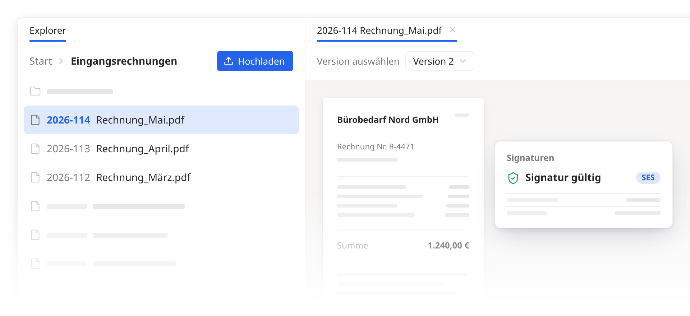

# DMS — Cloud-native, distributed document management system

This repository contains the implementation of the following system: an audit-proof, distributed DMS built as a microservice architecture (Python/FastAPI-first, Postgres with schema-per-service, event bus, plugin/connector extensibility).

<picture>
  <source media="(max-width: 600px) and (prefers-color-scheme: dark)" srcset="docs/assets/og-doc-hero-compact-dark.png">
  <source media="(max-width: 600px)" srcset="docs/assets/og-doc-hero-compact-light.png">
  <source media="(prefers-color-scheme: dark)" srcset="docs/assets/og-doc-hero-dark.png">
  
</picture>

<sub>OG Doc's documents workspace, an illustration: filed, numbered, previewed, signed. Built with <a href="libs/dms-showcase/README.md"><code>libs/dms-showcase</code></a>.</sub>

## Entry points

| Document | Purpose |
|---|---|
| Concept | Functional/technical concept — source of truth for all decisions |
| [`IMPLEMENTATION_PLAN.md`](IMPLEMENTATION_PLAN.md) | Session roadmap: which phase/session builds what, in which order |
| [`PROGRESS.md`](PROGRESS.md) | **Living tracker** — every new work session starts here: status, next step, open decisions |
| [`CONTRIBUTING.md`](CONTRIBUTING.md) | Conventions: Definition of Done, service structure, commit style |
| [`docs/architecture.md`](docs/architecture.md) | Architecture diagram of the current state (updated at phase boundaries) |
| [`docs/adr/`](docs/adr/) | Architecture Decision Records |
| [`docs/services/`](docs/services/) | A short doc per service (responsibility, API, schema, events) |
| [`docs/service-template.md`](docs/service-template.md) | Binding pattern for a new service (layout, pyproject.toml, Dockerfile) |

## Monorepo layout

```
services/   # One folder per microservice (src/, tests/, Dockerfile, README.md, pyproject.toml)
apps/       # Frontend applications (Next.js, static export - Concept 8, see ADR 0006)
libs/       # Shared Python packages (see libs/README.md for the full list)
infra/      # docker-compose.yml (local dev environment) + k8s/ (later)
tools/cli/  # DMS CLI tool
docs/       # ADRs + service documentation
```

Each service is independently containerized and deployable (principle from Concept 3.1/10.2) — the monorepo only serves the development phase (shared conventions, a single `docker-compose up` for everything).

## Local development environment

```bash
cd infra
cp .env.example .env   # adjust values if needed
docker compose up -d
```

Starts Postgres, NATS JetStream, Keycloak, and MinIO as base infrastructure. Functional services are added starting with Phase 1 of the roadmap.

## Status

Current phase, latest status, and next step: see [`PROGRESS.md`](PROGRESS.md).
